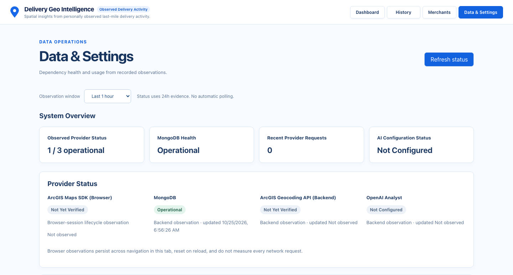
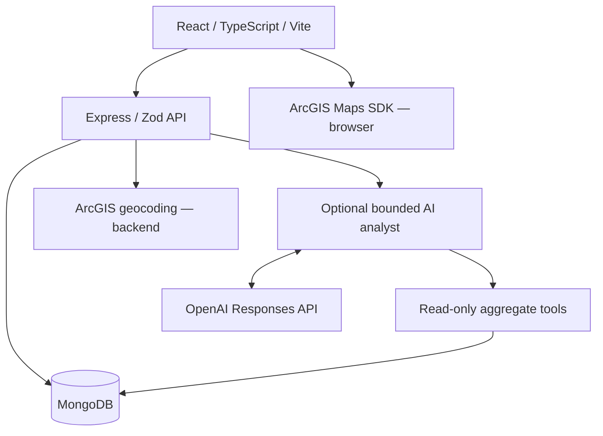

# Delivery Geo Intelligence

[](https://github.com/Shaobangzhu/delivery-geo-intelligence/actions/workflows/ci.yml)

A full-stack geospatial application for understanding **personally observed last-mile delivery activity**: pickup distribution, operating efficiency and the economic tradeoffs of recorded payouts, vehicle costs and settlement periods.

DGI is a **local, single-process proof of concept** built from a convenience sample. Its maps and rankings describe recorded observations; they do not represent overall consumer demand or the delivery market.

**Stack:** React 19 · TypeScript · Vite · React Router · Express · Zod · MongoDB native driver · ArcGIS Maps SDK for JavaScript · optional OpenAI Responses API.

[Application](#application) · [Architecture](#architecture) · [Quality engineering](#quality-engineering) · [Verified metrics](#verified-quality-metrics) · [Quick start](#quick-start) · [Documentation](#documentation)

## Application



*Actual application, October 25, 2026: synthetic E2E fixtures, real local API/MongoDB, offline ArcGIS SDK adapter, injected geocoding and no OpenAI configuration. No personal records or Home coordinates. This does not verify live ArcGIS rendering/connectivity. [Capture boundaries](docs/e2e-testing.md#readme-showcase-screenshot).*

| Page | Implemented capabilities |
| --- | --- |
| **Dashboard** · `/dashboard` | Calendar/category filters, earnings, charts, rankings and ArcGIS activity maps; delivery/session economics and settlement-aware efficiency. |
| **History** · `/history` | Delivery CRUD, Prop 22 receipts/reconciliation, explicitly linked sessions, vehicle assumptions, annual mileage and read-only statements. |
| **Merchants** · `/merchants` | Public pickup-location CRUD, server-side geocoding and deletion protection for referenced merchants. |
| **Data & Settings** · `/settings` | Observed dependency health, 1h/24h metrics, MongoDB ping, reported AI tokens and browser map status. Refresh makes no paid-provider probes. |

**Missing is not zero.** Cash receipts and settlement work periods are separate accounting views; complete-session rates require explicit links and valid denominators. Destination addresses/exact geocodes are discarded after coordinate generalization. Reduced precision is not an anonymity guarantee.

[Dashboard and GIS behavior](docs/dashboard.md) · [Analytics and accounting decisions](docs/analytics-model.md) · [Privacy model](docs/privacy-model.md)

## Architecture



- **Local application.** Frontend/backend run on the host; Compose runs MongoDB only. Zod validates inputs. A process queue coordinates related writes/reads, without distributed transactions.
- **Deterministic finance before AI.** Domain services own facts, cohorts, units and completeness. The analyst explains allowlisted aggregates; it cannot write records or generate queries.
- **Separate geography.** Public merchant points retain precision; destinations follow geocode → generalize → discard. Browser/backend ArcGIS credentials are distinct. One MapView survives filter changes.
- **Observed operations.** Settings separates backend metrics from browser lifecycle events. Configuration alone never means healthy. Bounded in-memory metrics reset on restart.

[System architecture](docs/architecture.md) · [Data model and API](docs/data-model.md) · [Geocoding contract](docs/geocoding.md) · [Telemetry definitions](docs/observability.md)

## Quality engineering

The [CI workflow](.github/workflows/ci.yml) runs on PRs targeting `main`, pushes to `main` and manual dispatch. Its aggregate **Quality gate** requires every mandatory stage to succeed.

- **Blocking signals.** Lint, types, builds, tests, coverage, security and reporting must succeed. Failed/skipped/cancelled prerequisites and flaky Chromium retries fail the gate. Merge enforcement additionally requires [GitHub protection](docs/ci.md#required-github-side-setup-not-applied), whose activation is not claimed.
- **Isolated data.** Native Node tests and real-driver MongoDB integration use injected providers and disposable databases. URI/namespace guards bound cleanup; CI needs no personal data or live credentials.
- **Real application boundaries.** [Chromium smoke tests](e2e/smoke.spec.ts) cover filters/analytics, delivery edits/validation, merchant CRUD and Settings failures/refresh through React, Express and MongoDB. Only the SDK/provider boundaries are mocked.
- **Coverage non-regression.** Vitest/V8 and c8 include unimported production modules. Separate statement/branch/function/line floors preserve each workspace baseline, without averaging percentages or imposing an arbitrary 80%.
- **Fault/privacy regression.** [Injected provider failures](backend/test/reliability.test.mjs), [Mongo classification](backend/test/qualityAudit.test.mjs) and [Settings contracts](frontend/src/settings/Settings.test.tsx) cover deadlines, malformed data, unknown states, denominators and privacy. Telemetry failure must not break business requests.
- **Useful failure evidence.** Allure 3 collects Node/Vitest/Playwright outcomes during existing executions. Available diagnostics survive failures; test exit codes remain blocking. Public candidates remove screenshots/traces and pass a strict privacy audit.

`npm run quality:demo` demonstrates **137 pass → two health tests fail after a temporary regression → 137 pass after restoration**, using the blocking backend command and separate sanitized reports in a disposable copy. [Reproduce it](docs/quality-gate-demo.md).

## Verified quality metrics

Latest successful main CI inspected: **October 25, 2026**, commit `d4d40a9`, [run 40171656999](https://github.com/Shaobangzhu/delivery-geo-intelligence/actions/runs/40171656999). **All 12 checks succeeded.** The following values come from that run's logs:

| Layer | Passing executions | Coverage: statements / branches |
| --- | ---: | ---: |
| Backend · native Node coverage suite | 178 | 94.44% / 92.19% |
| Frontend · Vitest coverage suite | 144 | 89.45% / 84.92% |
| Chromium E2E smoke | 9 | Not a coverage measurement |
| Offline AI evaluation | 39 scenarios | Zero real provider calls |

Unit/integration jobs overlap with coverage jobs; do not sum them as unique tests. Allure contains **653 executions across these batches**, not 653 distinct cases. See the [audit](docs/quality-architecture.md#fresh-validation-and-coverage) for function/line coverage, floors and limits. These dated measurements do not guarantee reliability.

**Reports:** download `consolidated-test-report` from CI or generate HTML locally. [Release 40171854177](https://github.com/Shaobangzhu/delivery-geo-intelligence/actions/runs/40171854177) restored trusted-main history and audited a candidate; Cloudflare upload was **skipped**. No public report URL or hosted application is claimed. Publication requires bundle security review and enablement. [Allure](docs/allure-reporting.md) · [Separate report hosting/history/Access setup](docs/cloudflare-allure-deployment.md).

## AI Operations Analyst

Dashboard's **Ask DGI** panel invokes OpenAI only after an explicit submission. Seven strict, read-only tools expose compact aggregates for activity, delivery/session efficiency, strategies, settlement completeness and independent annual statements.

The server validates arguments/structured output, binds facts to request-specific provenance and renders numbers from deterministic evidence. Scope/cohort guards constrain comparisons. Tools cannot write records or generate queries; outputs exclude raw location data.

Rounds, executions, payloads, output tokens and time are bounded; SDK retries are disabled. Provider context excludes stored notes, addresses and coordinates. Questions still reach OpenAI; do not include private information. `store: false` does not promise zero retention.

The **39 scripted scenarios** test orchestration, grounding and failures. Real model selection, language quality and billing remain unmeasured. Analytics work without OpenAI.

[AI tool/API reference](docs/architecture.md#ai-tool-and-http-reference) · [Evaluation and limitations](docs/ai-evaluation.md) · [AI privacy boundary](docs/privacy-model.md#prompt-b-ai-explanation-data-boundary)

## Quick start

Use **Node 22.23.4** (`.nvmrc`), npm **10.9.0** and Docker Desktop/Compose. Install at the workspace root. Keep the checkout outside cloud-synced folders to avoid dehydrated dependency/Git files.

```sh
nvm use                       # or select the .nvmrc version with your version manager
npm ci
cp .env.example .env
cp backend/.env.example backend/.env
cp frontend/.env.example frontend/.env
```

Configure the private local files before starting:

| File | Required configuration |
| --- | --- |
| `.env` | Set `DGI_MONGO_ROOT_USERNAME` and a private `DGI_MONGO_ROOT_PASSWORD` for Compose. |
| `backend/.env` | Set `MONGODB_URI` with those credentials, loopback port 27017, database `delivery_geo_intelligence` and `authSource=admin`; URL-encode password characters. Set the backend-only `ARCGIS_GEOCODING_API_KEY`. Defaults: `PORT=3000`, `DESTINATION_COORDINATE_DECIMALS=2`. |
| `frontend/.env` | Set the distinct browser-consumed `VITE_ARCGIS_API_KEY`. Leave optional `VITE_DGI_HOME_LONGITUDE` / `VITE_DGI_HOME_LATITUDE` empty for shared builds and screenshots. |

`OPENAI_API_KEY` is optional in `backend/.env`; `OPENAI_MODEL` defaults to `gpt-4.1-mini`. The backend requires its geocoding credential at startup. Browser map credentials are browser-visible; never put the backend geocoding key in a `VITE_` variable.

```sh
npm run db:up                  # MongoDB only; waits for the healthcheck
npm run dev:backend            # terminal 1 — http://127.0.0.1:3000
npm run dev:frontend           # terminal 2 — http://127.0.0.1:5173
```

Open [127.0.0.1:5173](http://127.0.0.1:5173). Start with a verified public merchant, then record deliveries in History. Startup creates indexes, not personal history. [Explicit initialization and annual imports](docs/data-model.md#explicit-local-initialization-and-annual-import).

### Run quality checks without application credentials

```sh
npm run quality:check          # lint, types, credential-free build, coverage, offline AI, floors
npm run security:check         # production and full dependency-tree audits
npx playwright install --only-shell chromium
npm run test:e2e               # automatic offline servers + synthetic MongoDB
```

Tests use disposable MongoDB without real `.env`, personal records or paid calls; initial package/browser/binary downloads need network access. Security and Chromium checks run separately from `quality:check`. [Local/CI parity](docs/ci.md).

```sh
npm run allure:test            # execute each layer once; generate consolidated HTML
npm run allure:open            # serve artifacts/allure-report on loopback
```

`allure:generate` merges existing results; `allure:clean` retains JSONL history. Node 22 uses backend reporter-only mode. `build:quality` disables environment-file loading; normal `build` retains it. `db:down` preserves the data volume.

## Documentation

| Area | Start here |
| --- | --- |
| Architecture and API | [System design](docs/architecture.md), [collections/endpoints/imports](docs/data-model.md) |
| Analytics and economics | [Dashboard/GIS](docs/dashboard.md), [accounting and completeness](docs/analytics-model.md) |
| Spatial privacy | [Geocoding](docs/geocoding.md), [privacy decisions and limits](docs/privacy-model.md) |
| Quality Engineering and CI | [Baseline/tooling](docs/quality-engineering.md), [required checks/protection setup](docs/ci.md), [final architecture audit](docs/quality-architecture.md) |
| Regression and E2E | [Fault/privacy tests](docs/reliability-testing.md), [Chromium isolation](docs/e2e-testing.md), [gate demonstration](docs/quality-gate-demo.md) |
| AI | [Tool/API reference](docs/architecture.md#ai-tool-and-http-reference), [offline evaluations](docs/ai-evaluation.md) |
| Observability | [Metrics and status definitions](docs/observability.md), [Data & Settings](docs/data-settings.md) |
| Test reporting | [Allure 3](docs/allure-reporting.md), [optional static-report release/history](docs/cloudflare-allure-deployment.md) |
| Technical walkthrough | [Interview demonstration and evidence-based resume bullets](docs/doordash-interview-demo.md) |

## Current scope and limitations

- **Local PoC.** Multi-user authentication, distributed coordination, production hosting and large-scale operation are not demonstrated.
- **Convenience sample.** Cash income, sessions, settlement periods and annual aggregates have distinct scopes and are not interchangeable or additive.
- **Synthetic validation.** CI does not establish live ArcGIS/OpenAI availability, WebGL correctness, model accuracy or a historical flakiness rate.
- **Explicit limits.** Rounding is not anonymization; configured Home values are browser-visible. Metrics reset on restart. Access, deployment secrets and GitHub protection require independent verification.

DGI is an independent portfolio project with no claimed affiliation with DoorDash, Uber or Esri. Further deployment and scalability work require their own design and validation.
