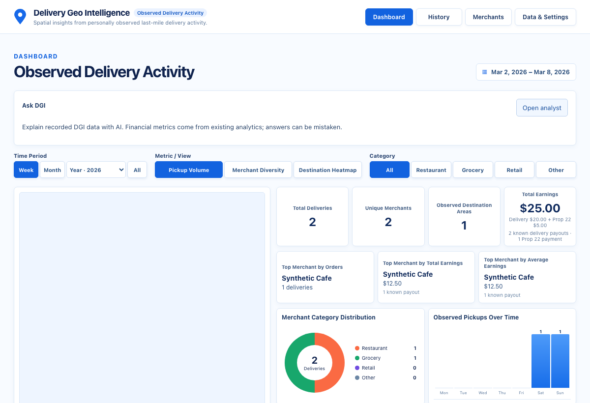
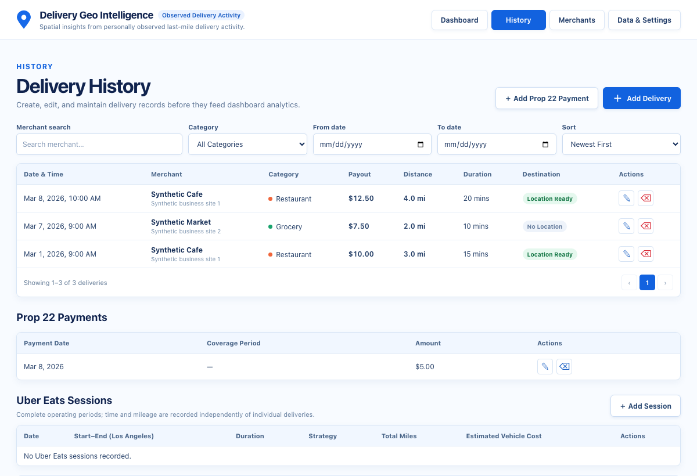
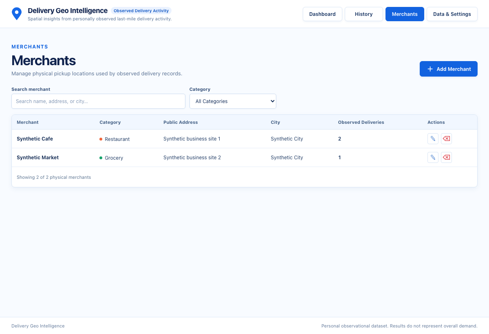
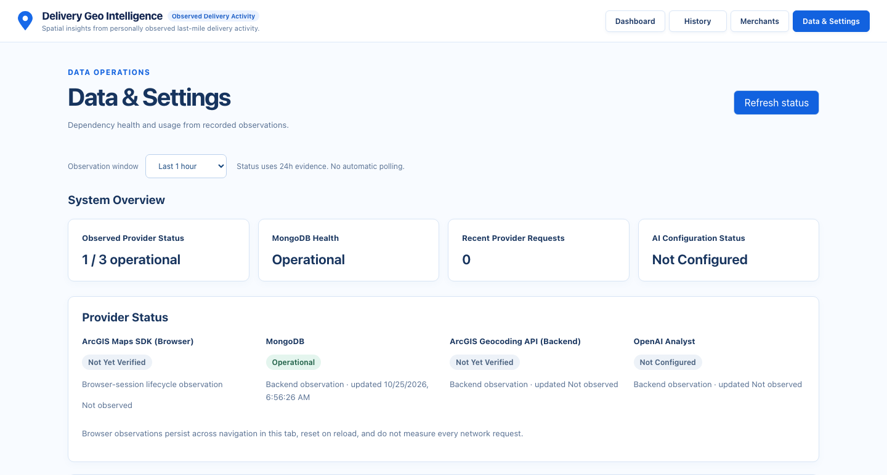
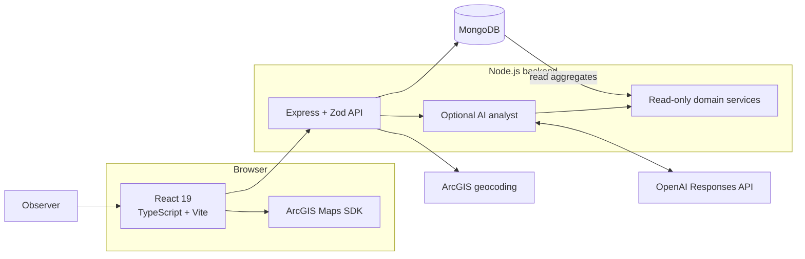
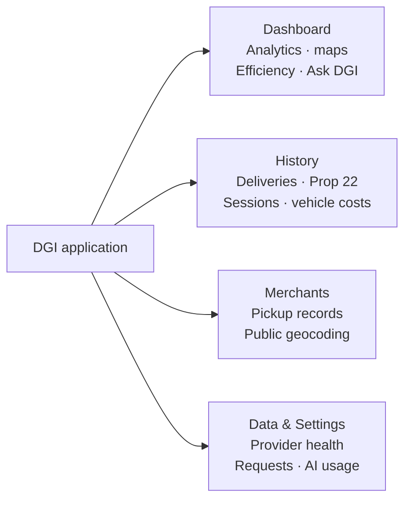
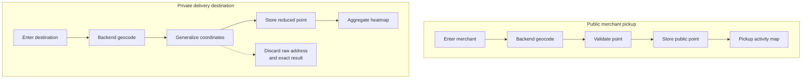
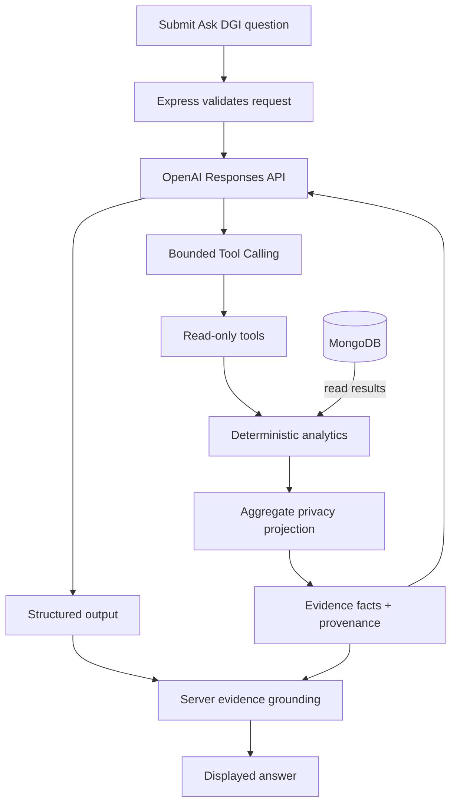
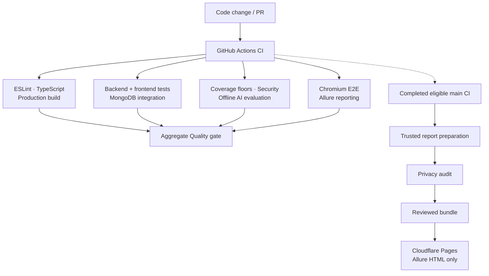

# Delivery Geo Intelligence

[](https://github.com/Shaobangzhu/delivery-geo-intelligence/actions/workflows/ci.yml)

Explore **personally recorded last-mile delivery activity** through maps, earnings, operating efficiency, and an optional evidence-grounded AI analyst. DGI is a local full-stack application built around a convenience sample, so its maps and rankings describe recorded activity rather than market-wide demand.

**MERN + TypeScript** · React 19 · Node.js / Express · MongoDB native driver · ArcGIS · optional agentic AI (OpenAI Responses) · quality-gated CI

[CI runs](https://github.com/Shaobangzhu/delivery-geo-intelligence/actions/workflows/ci.yml) · [Public Allure quality report](https://dgi-quality-report.pages.dev/) · [Quick start](#quick-start) · [Engineering docs](#engineering-docs)

## Application preview

### Dashboard



*Two synthetic deliveries in the selected week produce the visible summary and charts. The pale map canvas uses the offline SDK adapter; this capture does not verify a live ArcGIS basemap.*

### History



*Three synthetic delivery records and one synthetic Prop 22 payment demonstrate the list and entry controls.*

### Merchants



*Two synthetic public pickup locations demonstrate merchant search and management.*

### Data & Settings



*The Dashboard, History, and Merchants captures were taken November 1, 2026 in isolated Chromium at 1200 × 820; this Settings capture was taken October 25, 2026. All use synthetic E2E fixtures, a local Express API and disposable MongoDB, an offline ArcGIS SDK adapter, injected geocoding, and no OpenAI configuration. They contain no personal records or Home coordinates. No capture verifies live ArcGIS rendering or connectivity. [Capture boundaries](docs/e2e-testing.md#readme-showcase-screenshots).*

## MERN architecture



React owns interaction and browser maps; Express validates requests and owns persistence, geocoding, analytics, and optional AI orchestration.

| Layer | Responsibility |
| --- | --- |
| **React + TypeScript** | Four routed pages, forms, charts, browser ArcGIS map lifecycle. |
| **Node.js + Express + Zod** | Validated HTTP API, business rules, provider boundaries, read-only analytics and AI tools. |
| **MongoDB native driver** | Merchant, delivery, settlement, session, vehicle, and annual records; no Mongoose layer. |
| **ArcGIS** | Browser Maps SDK for visualization; separate backend geocoding for submitted locations. |
| **OpenAI Responses API** | Optional analyst invoked by an explicit user question. |

The frontend and backend run locally on the host; Docker Compose starts MongoDB only. The application has no public hosting or multi-user authentication. [Architecture and API](docs/architecture.md) · [Data model](docs/data-model.md).

## Product at a glance



The four routes let one observer record work, inspect its geographic and economic patterns, manage public pickup locations, and inspect observed dependency health.

- **Dashboard** (`/dashboard`) filters recorded deliveries by period and category, then shows earnings, rankings, maps, efficiency, and Ask DGI.
- **History** (`/history`) maintains deliveries, Prop 22 receipts, linked work sessions, vehicle assumptions, and independent annual statements.
- **Merchants** (`/merchants`) manages public pickup locations and geocodes their addresses on the backend.
- **Data & Settings** (`/settings`) shows backend and browser-session observations over 1h/24h windows; refresh makes no paid-provider probe.

Missing earnings, time, mileage, and settlement links stay unknown until recorded. Cash receipts, work periods, and annual statements have separate accounting scopes. [Analytics rules](docs/analytics-model.md) · [Page behavior](docs/dashboard.md) · [Settings contract](docs/data-settings.md).

## How data becomes insight

```mermaid
flowchart LR
  Action["Record a delivery"] --> Form["React History form"]
  Form --> Post["POST /api/deliveries"]
  Post --> Validate["Zod validation"]
  Validate --> Save["MongoDB delivery"]
  Save --> Open["Open Dashboard"] --> Get["GET /api/dashboard"]
  Get --> Compute["Deterministic analytics"]
  Compute --> View["React Dashboard"]
```



The observer enters records explicitly; a later Dashboard read derives summaries from saved data rather than persisting AI-generated metrics or importing delivery-platform activity automatically.

The backend computes calendar-filtered delivery totals, settlement-aware completeness, and session or vehicle economics with defined cohorts and denominators. A destination entered with a delivery also passes through the separate privacy flow below. [Analytics model](docs/analytics-model.md) · [HTTP and collections](docs/data-model.md).

## Geospatial intelligence and privacy



Public business pickup coordinates remain precise; submitted destination addresses and exact geocodes are transient, while only generalized destination points are saved for aggregate mapping.

The geocoder validates WGS84 results before storage. Generalization reduces spatial precision, **not** the risk of identifying a sparse observation; no private Home coordinates belong in shared builds or screenshots. Browser and backend ArcGIS keys have separate roles. [Geocoding contract](docs/geocoding.md) · [Privacy model](docs/privacy-model.md).

## Evidence-grounded AI analyst



After explicit submission, bounded model tool calls retrieve projected aggregates; the server validates selected fact IDs and renders its own values and provenance in the answer.

Seven strict tools cover activity, delivery and session efficiency, strategies, settlements, data quality, and independent annual summaries. The model cannot write records or issue arbitrary database queries. Requests omit stored notes, addresses, and coordinates, but the submitted question reaches OpenAI; avoid putting private information in it. Analytics work without an AI key. The offline scripted evaluation checks orchestration and grounding, not live-model accuracy. [AI implementation](docs/architecture.md#ai-tool-and-http-reference) · [Evaluation limits](docs/ai-evaluation.md) · [AI privacy](docs/privacy-model.md#prompt-b-ai-explanation-data-boundary).

## Quality engineering



The blocking Quality gate checks mandatory CI stages; a separate trusted-main release audits and publishes eligible static test diagnostics without changing test outcomes or hosting the DGI application.

The [CI workflow](.github/workflows/ci.yml) runs for PRs to `main`, pushes to `main`, and manual dispatch. It uses synthetic, isolated MongoDB data and mocked provider boundaries. A failed prerequisite, coverage floor, security check, or report job fails the aggregate gate; publication can retain eligible failure evidence. [Report release workflow](.github/workflows/quality-report.yml) · [CI details and branch-protection setup](docs/ci.md) · [Allure architecture](docs/allure-reporting.md).

### Measured main-branch evidence

On **November 1, 2026**, [main commit `f05d31b`](https://github.com/Shaobangzhu/delivery-geo-intelligence/commit/f05d31bdd3a8e369a8ac2dde2e8b137ebd7725af) completed [CI run 41357983707](https://github.com/Shaobangzhu/delivery-geo-intelligence/actions/runs/41357983707) with **12 successful jobs**. These are measured run results, not targets or stability estimates.

| Check | Verified result |
| --- | --- |
| Backend native Node coverage suite | 178 passed · statement 94.44% · branch 92.19% · function 96.93% · line 94.44% |
| Frontend Vitest coverage suite | 144 passed · statement 89.45% · branch 84.92% · function 88.18% · line 92.36% |
| Chromium E2E smoke | 9 passed against the application with synthetic fixtures and isolated providers |
| Offline AI evaluation | 39/39 scenarios · zero real provider calls |
| Allure report | 653 execution records across overlapping test batches; **not** 653 unique tests |

[Release run 41358311367](https://github.com/Shaobangzhu/delivery-geo-intelligence/actions/runs/41358311367) prepared the audited report and logged a successful Cloudflare Pages upload. The [public report hostname](https://dgi-quality-report.pages.dev/) serves static Allure HTML, while CI retains `consolidated-test-report` artifacts. This release review did not independently open the production site in a browser. The exact browser bundle is [approved through November 7, 2026 UTC](docs/allure-bundle-security-review.md); later uploads require a new review. GitHub branch protection was not active in the latest audit, so the workflow alone does not enforce PR merges. [Coverage and audit context](docs/quality-architecture.md) · [Publishing and history](docs/cloudflare-allure-deployment.md).

## Quick start

Use Node **22.23.4** from `.nvmrc`, npm **10.9.0**, and Docker Desktop/Compose. Run these commands at the repository root, preferably outside a cloud-synced folder:

```sh
nvm use
npm ci
cp .env.example .env
cp backend/.env.example backend/.env
cp frontend/.env.example frontend/.env
```

Set private local configuration before starting:

| File | Required values |
| --- | --- |
| `.env` | `DGI_MONGO_ROOT_USERNAME` and a private `DGI_MONGO_ROOT_PASSWORD` for Compose. |
| `backend/.env` | `MONGODB_URI` using those credentials, loopback port 27017, database `delivery_geo_intelligence`, and `authSource=admin`; URL-encode password characters. Set `ARCGIS_GEOCODING_API_KEY` for the backend. |
| `frontend/.env` | Set a separate browser-consumed `VITE_ARCGIS_API_KEY`. Keep optional Home coordinates empty in shared builds. |

`OPENAI_API_KEY` is optional in `backend/.env`; `OPENAI_MODEL` defaults to `gpt-4.1-mini`. The backend needs its geocoding credential at startup. Browser `VITE_` variables are visible to clients, so never place the backend key there. Default backend port is 3000; the frontend uses 5173.

```sh
npm run db:up            # MongoDB only; wait for its healthcheck
npm run dev:backend      # terminal 1
npm run dev:frontend     # terminal 2
```

Open [127.0.0.1:5173](http://127.0.0.1:5173), add a verified public merchant, then enter your own deliveries in History. Startup creates indexes, not delivery history. [Explicit initialization and imports](docs/data-model.md#explicit-local-initialization-and-annual-import).

### Run quality checks without application credentials

```sh
npm run quality:check    # lint, types, credential-free build, coverage, offline AI, floors
npm run security:check   # production and full dependency-tree audits
npx playwright install --only-shell chromium
npm run test:e2e         # offline servers and synthetic MongoDB
npm run allure:test      # test layers once and generate consolidated HTML
npm run allure:open      # serve the report on loopback
```

The E2E command uses disposable MongoDB data and injected provider responses. Package, browser, and test MongoDB binary downloads may need network access. `security:check` and Chromium E2E run separately from `quality:check`. `allure:generate` builds HTML from existing results; `allure:clean` removes generated reports while retaining JSONL history. Node 22 uses Allure's native backend reporter-only mode. [Local and CI commands](docs/quality-engineering.md) · [E2E isolation](docs/e2e-testing.md) · [Allure commands](docs/allure-reporting.md).

## Engineering docs

| Topic | Deep dive |
| --- | --- |
| MERN architecture and data | [System/API](docs/architecture.md) · [Collections and endpoints](docs/data-model.md) |
| Analytics and GIS | [Dashboard](docs/dashboard.md) · [Accounting and completeness](docs/analytics-model.md) · [Geocoding](docs/geocoding.md) |
| Privacy and operations | [Privacy model](docs/privacy-model.md) · [Provider observations](docs/observability.md) · [Data & Settings](docs/data-settings.md) |
| AI | [Tools and API](docs/architecture.md#ai-tool-and-http-reference) · [Offline evaluation](docs/ai-evaluation.md) |
| Quality and CI | [Quality baseline](docs/quality-engineering.md) · [Reliability tests](docs/reliability-testing.md) · [CI gate](docs/ci.md) · [Gate failure demo](docs/quality-gate-demo.md) |
| Reporting | [Allure 3](docs/allure-reporting.md) · [Cloudflare static report/history](docs/cloudflare-allure-deployment.md) |

## Scope and limits

- **Local proof of concept:** The application has one Express process and local MongoDB. Multi-user authentication, distributed coordination, production application hosting, and scale testing are outside the demonstrated scope.
- **Convenience sample:** Recorded deliveries do not represent overall demand. Missing values stay unknown; delivery, session, settlement, and annual measures have different time and accounting bases.
- **Geography:** Reduced coordinate precision is not anonymization. Sparse observations and browser-visible optional Home settings still need care.
- **Validation:** CI does not prove live ArcGIS/OpenAI availability, WebGL behavior, model accuracy, or a historical flakiness rate. Process-local provider metrics reset on restart.

DGI is an independent portfolio project with no claimed affiliation with delivery platforms or map providers.
