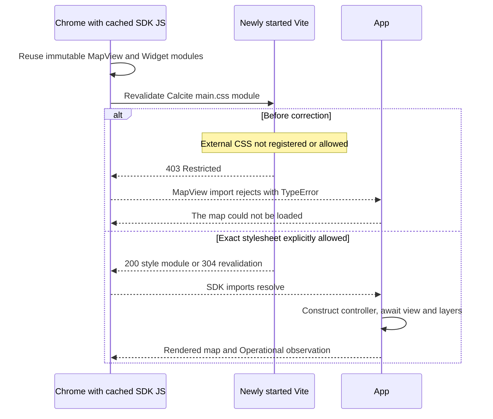

# ArcGIS cold start failure from cached Calcite imports

Confirmed and fixed on November 2, 2026, on `fix/vite-calcite-css-cold-start`.

The original first-load failure was reproduced with the real SDK, normal development scripts, and the exact `http://127.0.0.1:5173` origin. The cause is a required Calcite stylesheet outside Vite's filesystem allowance, combined with cached optimized JavaScript surviving a Vite restart. Ten post-fix first navigations passed with those caches retained.

## Confirmed failure mechanism

The installed dependencies are symlinked into an external cache. The generated ArcGIS module graph contains this static dependency chain:

```text
loadArcgis → MapView entry → MapView chunk → Widget chunk
          → @esri/calcite-components/dist/cdn/main.css
```

The Widget chunk imports the stylesheet as part of its JavaScript module graph. In development, Vite transforms the CSS import into a JavaScript style module. A rejected stylesheet request therefore prevents the MapView module graph from loading; it is not just missing visual styling.

Vite's import analysis records external imports in its process-local `safeModulePaths`. A newly started server loses that state. Optimized JavaScript responses carry `Cache-Control: max-age=31536000,immutable`, while the Calcite style module uses `no-cache`. With a warm browser, cached SDK JavaScript can bypass the new server's import analysis, while the CSS must still be revalidated. The external CSS path is then neither registered nor explicitly allowed and returns `403 Restricted`.

The application's eleven imports are awaited together in [arcgisRuntime.ts](../frontend/src/dashboard/arcgisRuntime.ts), lines 4–16. The captured failure is `import:views/MapView.js:failure`, a `TypeError` reporting `Failed to fetch dynamically imported module: .../@arcgis_core_views_MapView__js.js`. The rejected `loadArcgis` chain reaches [DashboardMap.tsx](../frontend/src/dashboard/DashboardMap.tsx), line 62, displays “The map could not be loaded,” and records map initialization failure. No controller or MapView is constructed on this path. This failure precedes remote basemap readiness and does not result from ArcGIS service latency or API-key rejection.

Vite documents its [external-file allowance](https://vite.dev/config/server-options#server-fs-allow) and [immutable dependency caching](https://vite.dev/guide/dep-pre-bundling#browser-cache). The causal conclusion here also rests on the actual failed request and the controlled before/after reproduction below.

## Natural failure and controlled reproduction

The user reproduced the failure on `main`. Inspection preserved the failed page and found a Calcite `main.css` 403 and an import failure about 84 ms into the active SDK-loading attempt. A direct request confirmed that the stylesheet existed but was outside Vite's serving allowance. Requesting the Widget importer caused Vite to register the CSS path, after which the identical CSS URL returned 200 and a separate Dashboard tab initialized successfully without a source change. This explained the server-state dependency, but did not yet prove which resources the browser had cached.

The subsequent controlled reproduction used installed Chrome with a persistent profile. Both ports were confirmed free before starting the repository's normal backend/frontend scripts. There was no alternate origin, local forwarding, forced optimization, cache clearing, synthetic SDK, injected failure, or artificial startup delay. The browser navigated as soon as Vite printed its ready URL; no preliminary frontend readiness fetch warmed the graph. Before restarting Vite, the browser moved to `about:blank` so its HMR connection could not prewarm the next server. Only harness-owned processes were stopped.

| Before the correction | Cached JavaScript responses observed by CDP | Calcite CSS | Map result |
| --- | ---: | --- | --- |
| First navigation in a new persistent profile | 0 | 200 | Initialized |
| Same browser/cache after normal Vite restart | 240 | 403 | Original error reproduced; no canvas or controller |

The earlier incognito-context comparison did not reproduce the failure and recorded zero cache hits on both passes. Switching to a persistent profile exposed the missing condition. This is why fresh-context tests and the earlier isolated/forced-optimization experiments could pass while the user's normal Chrome workflow failed.

## Targeted correction

[frontend/vite.config.ts](../frontend/vite.config.ts), lines 11–14 and 22, now resolves Calcite's public `main.css` export using a `createRequire` anchored at the installed ArcGIS package, then adds that exact file to `server.fs.allow`. Resolving from ArcGIS selects the Calcite copy its dependency graph uses, including nested installations, without hardcoding a cache directory or private absolute path.

The stylesheet is available on the first request of a new Vite process, independently of whether the importing JavaScript reaches import analysis. Only one additional file is allowed. Workspace detection, strict mode, deny rules, and the existing ArcGIS font allowance remain intact. No application initialization, retry, SDK version, API key, CDN, StrictMode, backend observation, or synthetic E2E adapter behavior changed.



## Regression and acceptance evidence

[viteAssets.test.ts](../frontend/src/test/viteAssets.test.ts), line 45, now requests the Calcite stylesheet before any SDK importer is requested. It failed before the configuration correction with `expected 403 to be 200` and passed afterward. This deterministic local HTTP test represents a browser reusing cached importers: the test server has no import-analysis registration for the external CSS. It also checks that a real sibling Calcite runtime file stays 403, unrelated external files stay 403, dotenv deny rules stay effective, strict mode remains enabled, and existing font serving continues to work. No real ArcGIS service calls are made by this test.

The same persistent Chrome profile that had failed was retained for post-fix testing. Four initial passes included filters, all three map modes, Settings, and visual inspection after tile traffic settled. Six further passes completed ten first-navigation checks across normal server starts. Every pass recorded 395 cached JavaScript responses, a successful CSS response/revalidation, `map_initialized`, a canvas, and no import failure. Cache clearing was never used to obtain success.

| Post-fix pass | Cached JS responses | CSS status | First-load result |
| --- | ---: | ---: | --- |
| 1 | 395 | 200 | Initialized |
| 2 | 395 | 200 | Initialized |
| 3 | 395 | 304 | Initialized |
| 4 | 395 | 304 | Initialized |
| 5 | 395 | 200 | Initialized |
| 6 | 395 | 304 | Initialized |
| 7 | 395 | 200 | Initialized |
| 8 | 395 | 200 | Initialized |
| 9 | 395 | 200 | Initialized |
| 10 | 395 | 200 | Initialized |

Basemap roads and both pickup heat concentrations were visually verified. Settings reported Operational on all four passes where it was checked, and the Dashboard time filter and pickup/diversity/destination modes remained functional.

After restoring the normal development servers, the user's existing Chrome profile also loaded `/dashboard` successfully: one canvas, no map error, and Operational in Settings.

| Existing quality script | Result |
| --- | --- |
| `npm run typecheck` | Passed frontend, backend/evals, and E2E typechecks |
| `npm run lint` | Passed with no warnings |
| `npm run test:frontend` | 239 tests passed in 23 files |
| `npm run build:quality` | Passed real-SDK frontend and backend builds; existing SDK chunk-size advisory remains |
| `npm run test:e2e -- --grep 'Dashboard\|Settings'` | Six offline cases passed, separate from the real-SDK checks above |

The correction covers the observed dependency graph and versions. A future SDK version introducing other externally resolved style files should be evaluated with the same first-request boundary test; the whole package/cache should not be allowed preemptively. Production bundling is covered by the quality build; the confirmed defect is specific to Vite development serving. Sensitive runtime records, browser profile files, and precise-location screenshots remain outside the patch.
