# ArcGIS cold start investigation v2

November 2, 2026 · Branch `fix/arcgis-cold-start-reliability-v2`

**Follow-up:** the subsequent natural reproduction and persistent-browser-cache experiment identified the Calcite CSS failure and verified a targeted correction. See [ArcGIS cold start failure from cached Calcite imports](arcgis-calcite-css-cold-start.md). The unresolved-cause statements below describe the evidence available during this earlier investigation.

**The visible console's ArcGIS font 403 defect is fixed and verified. The reported intermittent map load-chain failure has not been captured naturally, so this is not a claim that its root cause is resolved.** This investigation used the normal development scripts and the actual `http://127.0.0.1:5173` origin, including the user's running Chrome profile. No local request forwarding or synthetic SDK was used for the live experiments.

**User verification:** after the patch, the user answered “First load now works” when asked whether their usual stop/start and first Dashboard load still produced the error. This confirms the first-load outcome in the user's workflow, in addition to the automated verification below. It does not establish which change or environment condition eliminated the earlier failure.

## Reproduction and preserved baseline

[PR 14](https://github.com/Shaobangzhu/delivery-geo-intelligence/pull/14) was reviewed together with [the previous report](arcgis-cold-start-investigation.md) and [its measurements](arcgis-cold-start-evidence.json). Its ten restarts used forced optimization, an isolated 5174 server/cache, forwarding, and fresh browser contexts. Those runs did not reproduce normal startup or the user's browser cache/profile. Their successes were insufficient to establish first-load reliability in the user's workflow.

Before starting this investigation, process inspection found no listeners on 3000 or 5173. The existing dependency optimizer metadata was copied for local comparison. Dependencies remained symlinked to an external cache; no initial cache cleanup, dependency reinstall, `--force`, or environment change was performed.

The backend was started with `npm run dev:backend`; the frontend with `npm run dev:frontend`. Installed Google Chrome was launched before frontend readiness, then opened `/dashboard` on 5173. Vite itself reported automatic reoptimization because its configuration hash had changed; this was recorded rather than forced. No failed SDK JavaScript responses occurred. The map rendered and Settings reported Operational. CDP captured handled StrictMode request cancellations and an SDK SVG/JSON parsing exception; neither propagated into the application's map error. A caught exception is not by itself evidence of a failed initialization.

The actual running Chrome profile was then opened and inspected through its native DevTools console. The map was visible while two WOFF2 requests returned 403. A normal stop/start and page load also rendered the map. The user's prompt to inspect the console led to direct examination of those font URLs, rather than interpreting every console error as the map failure.

Only investigation-owned development processes were stopped/restarted. MongoDB and unrelated applications were not terminated; application data was not modified.

## Confirmed root cause of the console 403s

[DashboardMap.tsx](../frontend/src/dashboard/DashboardMap.tsx), line 8, imports the local ArcGIS light theme. Its `@font-face` rules reference these files under `@arcgis/core/assets/esri/themes/base/fonts/fonts/`:

- `09ab0626-bb45-4650-acc8-0182d693df02.woff2`
- `b8b15cdf-85d1-4120-8daa-48863d803939.woff2`

Both installed files exist. Vite rebases the CSS URLs to the package's external dependency realpath, yielding `/@fs/<dependency-cache>/node_modules/@arcgis/core/assets/esri/themes/base/fonts/fonts/<filename>`. The original filesystem allowlist covered the workspace and Vite client, excluding these external fonts. Vite returned `403 Restricted` and reported that the request was outside its serving allowlist. These were local font requests, not ArcGIS authentication requests.

[frontend/vite.config.ts](../frontend/vite.config.ts), lines 7–10 and 18, now resolves the installed stylesheet and allows only its theme font directory in addition to the normal workspace root. No user-specific path is hardcoded. `server.fs.strict` remains enabled, the default deny rules remain effective, and the dependency cache's parent directories are not allowed. This follows Vite's [documented filesystem allowlist behavior](https://vite.dev/config/server-options#server-fs-allow), including preserving workspace detection when adding an explicit allowance.

The correction applies to development asset serving. Normal production builds already emit hashed font assets and continue using the real SDK. No SDK version, CDN, API key permissions, or initialization ordering changed.

**Causal limit:** the original map error was absent before this font correction as well as afterward. The evidence supports fixing the font requests, not attributing the intermittent map failure to them.

## Original exception and stage capture

No original map load-chain exception was observed naturally in this session. There is consequently no verified failing module URL or constructor exception to report for that incident. No artificial module failure was substituted for a natural baseline.

Previously, every rejection from imports or synchronous setup disappeared into the same catch. [DashboardMap.tsx](../frontend/src/dashboard/DashboardMap.tsx), lines 27–62, now captures development-only evidence for:

- Effect setup, cleanup, cancellation, and a distinct attempt identifier.
- SDK import start/completion, key configuration completion without its value, controller construction, and initial feature submission.
- The original error name, message, sanitized stack, and bounded cause chain on failure, with its stage.
- Browser status observations on the active attempt; cancelled attempts do not publish failure status.

Each literal import remains statically analyzable by Vite and is separately observed in [arcgisRuntime.ts](../frontend/src/dashboard/arcgisRuntime.ts), lines 5–15. A rejected import is identified as, for example, `import:views/MapView.js:failure`, while a synchronous constructor throw is tagged `controller-construction:failure`. There are no uncontrolled import paths or retries.

[dashboardMapController.ts](../frontend/src/dashboard/dashboardMapController.ts), lines 43–80 and 94–110, records construction, each `view.when()`/`layer.when()`, and both LayerViews. Destruction is also recorded. The existing UI messages and browser/backend status semantics remain unchanged: asynchronous View/layer readiness still differs from the outer load-chain error, and Settings remains a last-lifecycle observation rather than a connectivity monitor.

[arcgisDiagnostics.ts](../frontend/src/dashboard/arcgisDiagnostics.ts), lines 15–64, keeps a maximum of 250 development records in `window.__DGI_ARCGIS_DIAGNOSTICS__`, emits `dgi:arcgis-diagnostic` events, and logs sanitized failures with the `[DGI ArcGIS]` prefix. `navigationMs` uses `performance.now()` for network correlation; `elapsedMs` measures the individual attempt. Configured key/home values, HTTP URL queries, data URLs, and private user paths are redacted. SDK objects, feature rows, and request headers are not retained. Diagnostic failures cannot replace the original rejected value.

Production bypasses the promise observer and returns its original promise; production trace factories return a no-op. Built JavaScript was checked for the diagnostic marker/buffer names and did not contain them. Diagnostics were also absent in the live production page.

## Startup comparisons and latency

| Experiment | Actual result |
| --- | --- |
| A: normal scripts, original optimizer cache, unmodified source, exact 5173 origin | First automated Chrome load rendered; Settings Operational; two font 403s; no failed SDK scripts. |
| Actual Chrome profile, before correction | Map visible with the same two font 403s; normal restart/load also succeeded. |
| B: fresh Chrome context with development capture, before font correction | First load and route remount initialized; font 403s remained. |
| Normal scripts after correction, navigating immediately on Vite's ready output | Three backend/frontend restarts; 3 initialized, 0 map failures; no font 403s or failed SDK scripts. No preliminary HTTP readiness request was used. |
| C: original origin, browser HTTP cache disabled through CDP | First load and route remount initialized; Settings Operational. |
| D: controlled `npm run dev -w frontend -- --force`, only after original-cache baselines | Initialized without a module rejection or map error. |
| E: normal production build with real SDK and local environment, previewed on 5173 | First navigation rendered; settled basemap roads and pickup heatmap visually verified; fonts 200/200; no HTTP failures or uncaught page errors; filters/modes worked; Settings Operational. |
| Remote basemap latency, exact 5173 origin | Delaying only basemap responses by 2.5 seconds each extended readiness to about 8.45 seconds after navigation, then initialized successfully. |

The three normal restart runs reached `map_initialized` 787.1, 646.3, and 735.9 ms after the active effect began. They are successful observations, not a statistical guarantee or proof of the missing original failure's cause.

The following timeline is from Experiment C after the font correction. It is a measured successful path, **not a reconstructed failure trace**. Times are milliseconds since navigation's performance time origin.

| Milestone | Time | Correlation |
| --- | ---: | --- |
| T0 navigation | 0 | `/dashboard` at the real original origin. |
| T1 active SDK import begins | 337.0 | Eleven literal dynamic imports; cancelled StrictMode attempt started at 335.0. |
| T2 all modules resolve | 557.5 | No failed SDK script responses. |
| T3 key configuration completes | 557.5 | Key value not captured. |
| T4 MapView constructor completes | 573.2 | Controller construction succeeds. |
| T5 `view.when()` resolves | 904.4 | Remote dependencies did not reject readiness. |
| T6 merchant and destination layers ready | 1,056.9 / 1,058.7 | Each promise observed independently. |
| T7 browser status Operational | 1,059.0 | Existing lifecycle observation. |
| T8 visually usable basemap/heatmap | Not measured in this run | Separately observed in the real Chrome profile; production screenshot after settled traffic verified roads/heatmap at 2,031 ms. A canvas alone was not accepted as visual readiness. |

In the delayed-basemap run, imports completed at 449.9 ms and MapView construction at 482.8 ms; layers were ready around 1,014 ms, but `view.when()` waited until 8,451.7 ms. Operational followed at 8,452.3 ms, with no map failure. The current map path contains no application initialization deadline. Slow successful requests therefore do not establish the cause of the load-chain failure. Authentication, timeouts, optimization invalidation, or lifecycle cancellation would each require an actual rejected operation to establish causality; none was captured for the reported failure.

The preserved original optimizer metadata already listed all eleven SDK entry points. Later rebuilding optimization succeeded. These observations do not establish an outdated dependency bug, so no speculative optimization configuration was added.

## Failing and corrected sequences

Only the font-serving failure has a verified before/after sequence. The missing map load-chain exception is deliberately not invented in this diagram.

```mermaid
sequenceDiagram
    participant Browser
    participant Vite
    participant SDK
    participant Status
    Browser->>Vite: Import SDK modules and ArcGIS theme
    Vite-->>Browser: SDK modules and CSS
    alt Original font serving boundary
        Browser->>Vite: External theme WOFF2 URL
        Vite-->>Browser: 403 Restricted
        Note over Browser: Font error visible while map can initialize
    else Corrected theme font allowance
        Browser->>Vite: Same external theme WOFF2 URL
        Vite-->>Browser: 200 font/woff2
    end
    Browser->>SDK: Configure key and construct controller
    SDK-->>Browser: View and FeatureLayers ready
    Browser->>Status: map_initialized
    SDK-->>Browser: LayerViews and rendered map
    Note over Browser,Status: Original intermittent load-chain rejection still needs capture
```

## Regression verification

The existing tests from PR 14 remain. New coverage adds:

- Delayed but successful SDK loading before the first view is created, in [DashboardMap.test.tsx](../frontend/src/dashboard/DashboardMap.test.tsx), line 513. Existing tests continue covering imports/recovery, constructor/readiness failure boundaries, StrictMode, route-style remounts, and destruction.
- Error identity, import-stage evidence, privacy redaction, pending operations, diagnostic-consumer isolation, and production promise identity in [arcgisDiagnostics.test.ts](../frontend/src/dashboard/arcgisDiagnostics.test.ts).
- Real local Vite HTTP behavior in [viteAssets.test.ts](../frontend/src/test/viteAssets.test.ts): both fonts return `200 font/woff2`, strict filesystem mode stays enabled, and an unrelated external file and workspace `.env.synthetic` remain 403. This test uses no ArcGIS service traffic and an isolated test optimizer cache.

| Required existing script | Result |
| --- | --- |
| `npm run typecheck` | Passed for frontend, backend, eval types, and E2E. |
| `npm run lint` | Passed, no warnings. |
| `npm run test:frontend` | 239 tests passed in 23 files. |
| `npm run build:quality` | Passed frontend real-SDK build and backend build. SDK chunk-size advisory remains. |
| `npm run test:e2e -- --grep 'Dashboard\|Settings'` | Six offline cases passed; these do not certify real ArcGIS loading. |
| Real-SDK normal production build and original-origin browser check | Passed separately as described above. |

## Remaining work and risks

The console's font failure is resolved, and the user has confirmed that first load now works in their usual workflow. The first-load acceptance outcome is therefore verified by both automated checks and the user's confirmation. Causal attribution remains unconfirmed: neither the unchanged normal-start baseline nor the actual Chrome profile produced the original application error during observation, so there is no captured original exception proving that the font correction eliminated it.

The normal development servers have been restored on 3000/5173. If the user's usual workflow produces the error, inspect the `[DGI ArcGIS]` entry and its corresponding failed request before navigating away or rebuilding caches. The import-specific stage, sanitized exception/stack/cause, attempt number, and elapsed/navigation clocks now survive the previous information loss. A module rejection can then be compared against Vite's optimization output, a synchronous throw against its construction stage, and a readiness rejection against the individual View/layer operation.

No arbitrary delay, retry, StrictMode removal, broad filesystem allowance, or console suppression was added. Browser status still reflects the last recorded lifecycle event and can overstate current provider unavailability after a transient error; changing those semantics is separate from proving the startup cause. Development observers add small scheduling overhead; production observers are removed/bypassed. Raw browser snapshots and credential-bearing production bundles are local ignored artifacts and are not part of the patch.
