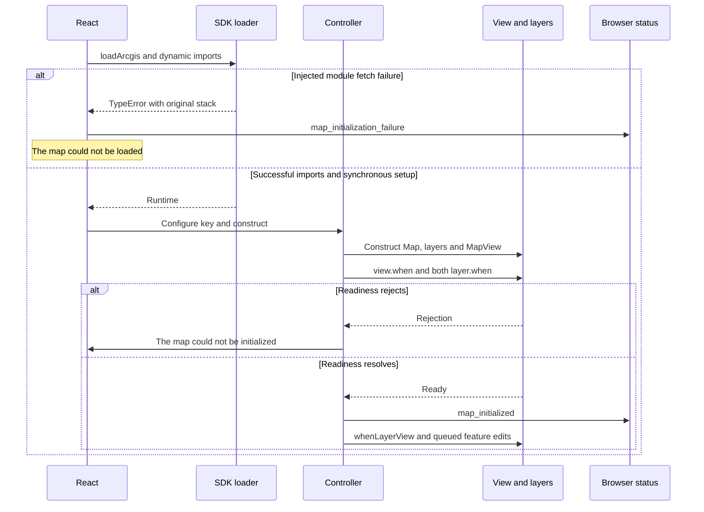

# ArcGIS Dashboard cold start investigation

Investigation date: November 2, 2026. **The original intermittent failure was not reproduced, and its root cause remains unconfirmed.** Ten controlled optimizer-cold starts and ten paired warm reloads initialized successfully with the real SDK. Local font 403s occurred alongside successful initialization. No production workaround was implemented.

The confirmed filesystem defect, an injected import failure, and the original reported failure are separate findings. Machine-readable measurements are in [arcgis-cold-start-evidence.json](arcgis-cold-start-evidence.json).

## 1 Root cause and evidence

The cause of the reported “The map could not be loaded” message cannot be selected reliably from the remaining hypotheses. That message narrows the failure to the SDK import and synchronous setup chain; the original exception is discarded at [DashboardMap.tsx](../frontend/src/dashboard/DashboardMap.tsx), line 45.

Confirmed findings:

- The installed `node_modules` folders are symlinks into an external dependency cache. This is an npm workspace with `package-lock.json`; installed versions were ArcGIS 5.1.25 and Vite 8.3.5. The cache location does not itself establish stale package contents or stale optimization.
- Two ArcGIS theme font files exist but are denied by Vite's default filesystem boundary. Their 403 responses are reproducible even when the map and both LayerViews initialize.
- An explicitly injected HTTP 503 for the optimized MapView module produces the exact reported message and Settings classification. The original exception is a `TypeError` with “Failed to fetch dynamically imported module,” a captured stack, and no cause. This is a demonstrated mechanism, **not evidence that a 503 or import failure caused the original incident**.
- A synchronous MapView constructor exception produces the same user message in a deterministic test. The message alone therefore cannot identify imports as the root cause.

No natural import rejection, optimization-related 504, synchronous controller exception, or readiness rejection was captured in the ten controlled starts.

## 2 Initialization stages and message boundaries

Dashboard mounts its map after analytics data exists ([Dashboard.tsx](../frontend/src/pages/Dashboard.tsx), lines 175–178); `MapPanel` passes map data at lines 78–82. Analytics success therefore does not establish SDK success.

| Boundary | Current behavior and source |
| --- | --- |
| Missing browser key | “Map configuration is missing”; `not_configured`. DashboardMap lines 27–31. |
| Eleven dynamic imports | `Promise.all` rejects if any import fails. [arcgisRuntime.ts](../frontend/src/dashboard/arcgisRuntime.ts), lines 1–14. |
| Configuration and synchronous setup | API key assignment, controller construction, initial feature setters, and initial metric setter share the import chain's catch. DashboardMap lines 33–45. Any throw here yields “The map could not be loaded.” |
| Controller construction | Map, merchant FeatureLayer, destination FeatureLayer, MapView, optional Home overlay, event registration, readiness setup, and initial renderers. [dashboardMapController.ts](../frontend/src/dashboard/dashboardMapController.ts), lines 41–108. |
| View or either layer readiness | `Promise.all([view.when(), merchantLayer.when(), destinationLayer.when()])` rejection yields “The map could not be initialized.” Controller lines 87–106. The aggregate loses which promise rejected. |
| LayerView creation | Separate “merchant map layer” or “destination heatmap layer” display messages; generic `layerview-create-error` has another display message. Controller lines 84–103. |
| Feature edits | Queued edits await `ready` before `applyEdits`. Rejections produce “could not be updated” messages, including failures inherited from `ready`. Controller lines 176–224 and 237–285. |

The outer `.then` does not return the controller's readiness promise. Consequently, an asynchronous `view.when()` rejection does not travel into the outer “loaded” catch. Exceptions inside the controller's readiness `.then` can also reject that aggregate chain. Subsequent synchronous prop-update effects at DashboardMap lines 53–55 are outside the original load-chain catch.



## 3 Local Vite 403 responses

The complete URL shape captured locally was:

```text
http://127.0.0.1:5173/@fs/<dependency-cache-realpath>/node_modules/@arcgis/core/assets/esri/themes/base/fonts/fonts/09ab0626-bb45-4650-acc8-0182d693df02.woff2
```

The other observed filename was `b8b15cdf-85d1-4120-8daa-48863d803939.woff2`. The private absolute cache prefix is intentionally omitted.

Both resources are WOFF2 fonts, not JavaScript modules, cloud API calls, or SDK runtime workers. DashboardMap imports `@arcgis/core/assets/esri/themes/light/main.css` at line 7. The installed stylesheet's first line contains Avenir Next `@font-face` rules with `url(../base/fonts/fonts/<filename>.woff2)`. Vite rebases these relative URLs to the resolved external package location. The observed browser initiator was reported by CDP as `other`; the stylesheet-to-font relationship was verified separately from the stylesheet contents and transformed URL, rather than inferred from an unavailable initiator stack.

A direct request to the original development server returned HTTP 403 with an HTML response containing `403 Restricted` and `The request id ... is outside of Vite serving allow list.` Relevant headers included `Vary: Origin`, chunked transfer encoding, and keep-alive; no explicit Content-Type was present in that direct response. Browser requests also received the local origin's CORS header. There was no ArcGIS authentication challenge in this local response.

The file exists at its resolved location. The server's logged allowlist covered the repository workspace and Vite client directory, not the external font files. The installed Vite implementation checks `fs.deny`, imported safe-module paths, and `fs.allow`; its CSS asset URL handling does not make these font paths eligible through the JavaScript import-analysis safe-path mechanism. This explains why imported SDK modules and the stylesheet can load while their font URLs are blocked. The application supplies no filesystem override ([vite.config.ts](../frontend/vite.config.ts), lines 8–11).

This agrees with Vite's documented [filesystem boundary](https://vite.dev/config/server-options#server-fs-strict) and [CSS URL rebasing](https://vite.dev/guide/features#css). The existing stylesheet import is consistent with Esri's [Vite guidance for programmatically constructed MapViews](https://developers.arcgis.com/javascript/latest/vite/). Esri's [asset guide](https://developers.arcgis.com/javascript/latest/working-with-assets/) distinguishes local theme styles from additional runtime assets; changing the SDK asset host is not justified by these font failures.

## 4 Causality of the font failures

All ten cold/warm pairs encountered font 403s and still reported `map_initialized`. Both LayerViews completed on each cold pass. A separate temporary server configuration allowed only the two exact blocked font files, retaining the workspace boundary and strict mode: the map initialized and no HTTP failures were observed. That intervention was removed.

The observed font 403s are incidental to successful map initialization and are not sufficient to produce the reported error. This does not prove that every possible `/@fs/` 403 is harmless: a rejected JavaScript module or required runtime asset must be assessed separately. No such natural local module rejection was captured.

If font serving is repaired separately, resolve only these package asset files, or the required theme font subtree, from the installed package and retain the normal workspace root and `fs.deny` protections. Do not allow the user's home, Library, entire dependency cache, or disable `fs.strict`. A conventional in-workspace dependency installation is another environment option. Neither change is presented as a fix for the intermittent map failure.

## 5 Cold and warm comparisons

An existing backend and frontend were already running. They were preserved; the investigation did not restart MongoDB or mutate application data. An isolated Vite server was restarted ten times using a dedicated workspace optimizer cache and `optimizeDeps.force=true`. Each run opened a fresh Chromium context and then reloaded that context. Ordinary source used the real SDK.

The isolated server listened on 5174. Browser requests retained the working `http://127.0.0.1:5173` origin and forwarded local files to the isolated server. This avoids disturbing the existing server. Playwright routing disables browser HTTP caching, so the paired runs measure server/optimizer cold versus warm behavior, not warmed browser HTTP cache. Separate direct-origin runs tested normal browser caching.

| Experiment | Attempts and outcome |
| --- | --- |
| Forced optimizer cold, fresh Vite and browser context | 10 initialized, 0 failed, 0 incomplete; lifecycle success 1,837–2,285 ms after navigation time origin. |
| Paired reload, warm Vite, routing disables HTTP cache | 10 initialized, 0 failed, 0 incomplete; success 785–853 ms. |
| Existing warm server, direct navigation and normal cache | Initial navigation, reload, and route remount all initialized. |
| Fresh context with CDP browser cache disabled | Initialized. |
| Settings to Dashboard route navigation | Initialized. |
| Basemap requests deliberately delayed 2.5 seconds each | Initialized after about 8,110 ms; no application failure message. |
| Optimized MapView module fetch deliberately returns 503 once | Load-chain failure; after removing injection, route remount initialized without reload; subsequent reload initialized. |
| Only the two font files allowed in a temporary server | Initialized; no HTTP failures. |

The injected module failure demonstrates that a failed fetch can recover without reload in this Chromium/Vite environment. It does not demonstrate that dependency optimization healed an actual failure. Vite documents that [optimization and dependency caching](https://vite.dev/guide/dep-pre-bundling) are development behavior; no natural optimizer failure was captured here.

An excluded alternate-origin control used 5174 directly. Four completed cold/warm pairs remained pending, with failed basemap loading, HTTP 401 and SDK error code 498; imports and controller construction succeeded. The browser key was compared in memory and was identical on both origins. Returning the browser to the original origin restored successful loading. This establishes an origin-dependent experimental difference, not the provider's precise credential rule, which was not inspected. These pending runs did not display either application failure message and are not counted as reproductions or successful starts.

No application initialization timeout exists in the traced map path. Slow requests by themselves therefore do not explain the reported “loaded” failure. The eight-second timeout in Settings applies to backend observation requests ([Settings.tsx](../frontend/src/pages/Settings.tsx), lines 16–27), not MapView initialization.

## 6 React lifecycle findings

StrictMode remains enabled ([main.tsx](../frontend/src/main.tsx), lines 7–12). Real traces show setup, cleanup, then setup again. Both loaders can finish, but the cancelled branch returns before configuration or construction. One active controller is constructed. Cleanup marks cancellation before destroying the current view and clearing its ref (DashboardMap lines 34 and 46–49).

Controller callbacks check `destroyed`; cleanup removes registered handles and destroys the view (controller lines 288–295). Existing tests cover early unmount and late readiness; the new StrictMode test rejects the cancelled import after the active mount succeeds and verifies no failure replaces success. No evidence supports disabling StrictMode or inserting a startup delay.

The `latest` ref feeds current rows and metric into delayed initialization (DashboardMap lines 19–20 and 41–44). Queued feature work checks revisions and destruction. A readiness rejection can nevertheless be re-reported by queued edits, discussed below.

## 7 Observability accuracy

Browser state is a module-local last-event snapshot with a timestamp ([browserStatus.ts](../frontend/src/settings/browserStatus.ts), lines 2–3 and 14–20). It survives client-side route navigation, resets with the page's JavaScript realm on reload, and is not stored as a connectivity monitor. Settings documents this at line 47.

Current limitations:

- An import failure and synchronous setup failure both become `map_initialization_failure`; an SDK loading failure cannot be distinguished from MapView readiness failure in Settings. The original name, message, stack, and cause are not retained.
- Any failure event displays `Unavailable`, even if the failed operation was transient or only one layer update failed. It is an observation of the last operation, not proof of an ongoing provider outage (Settings line 32).
- `map_initialized` is emitted after View and FeatureLayer readiness but before LayerView completion and feature edits (controller lines 87–103). Operational does not certify all rendering, tiles, fonts, or future requests.
- A failed `ready` promise can first emit map initialization failure and then emit a layer update failure when queued edits awaiting that same promise reject (controller lines 177, 219–224, 238 and 279–285). Last-write-wins status can obscure the initiating failure.
- A later successful initialization replaces an earlier failure through `observeBrowserMap`. The injected failure/remount experiment verified recovery; navigation to Settings after failure showed the failure event. The ordinary successful navigation experiment showed Operational.
- Settings' Refresh button fetches backend snapshots; it does not retest or restart the browser map. A retained browser failure can remain visible until another map lifecycle event.

No polling, provider health-check traffic, or backend observability changes were introduced.

## 8 Changes and fix decision

No production fix is justified for an incident whose original exception has not been captured. Vite configuration, SDK version, runtime asset hosting, API key handling, map architecture, and synthetic E2E isolation remain unchanged. Temporary stage instrumentation was removed from all four production files.

Changes retained:

- [DashboardMap.test.tsx](../frontend/src/dashboard/DashboardMap.test.tsx), line 103: isolate browser observations between tests.
- The same file, lines 452–510: five deterministic tests cover import rejection/recovery, synchronous constructor rejection, asynchronous readiness rejection, pending readiness, and cancelled StrictMode import rejection. These establish failure boundaries; they do not claim regression coverage for an unconfirmed original root cause or preservation of exceptions that current production code discards.
- This report and sanitized measurements in `docs/arcgis-cold-start-evidence.json`.

## 9 Verification and limitations

| Existing script | Result |
| --- | --- |
| `npm run typecheck -w frontend` | Passed. |
| `npm run lint -w frontend` | Passed, zero warnings. |
| `npm test -w frontend` | Passed: 20 files, 159 tests, including 28 DashboardMap cases. |
| `npm run build -w frontend -- --mode quality` | Passed: normal real-SDK production build, credential-free mode. Existing SDK bundle chunk-size advisory remains; no production source change contributed to it. |
| `npm run test:e2e -- --grep 'Dashboard\|Settings'` | Passed: six cases, using the existing offline SDK contract adapter. |

Deterministic CI tests do not make real ArcGIS calls. Live browser experiments did use the real SDK and services. Real-WebGL testing and offline E2E testing establish different properties; the adapter cannot verify cloud availability or actual basemap rendering ([vite.e2e.config.ts](../frontend/vite.e2e.config.ts), lines 5–17; [e2e/arcgis-runtime.mjs](../e2e/arcgis-runtime.mjs), lines 1–3).

Ten controlled starts are a finite sample, with temporary instrumentation and local forwarding. They do not reproduce a full machine restart, reinstall dependencies, restart the existing backend, validate every browser, or prove the original intermittent issue resolved. One early exploratory 5174 run also remained pending; it was excluded before the origin-controlled series. No naturally failing initialization stack exists to compare with the successful traces.

## 10 Residual risks and next experiment

The highest-value next experiment is to capture the next **natural** load-chain exception at the original origin before changing caching or filesystem settings:

1. Keep the user's normal `127.0.0.1:5173` origin and current credentials. Restart the normal frontend/backend in the user's reproduction setup, preserving browser network logs and recording whether the dependency cache is warm. Do not run competing Vite instances against the same optimizer cache.
2. Temporarily give the catch at DashboardMap line 45 an `error` parameter and place a debugger breakpoint there. Track a local stage variable across import, config assignment, construction, and initial setters. Add success/failure observers individually around `view.when`, each `layer.when`, and each `whenLayerView`, plus cleanup. Do not replace the SDK or add retries.
3. On a natural failure, capture stage, elapsed time, error name/message/stack/cause, the exact rejected module request and initiator, status and body, and Vite optimizer output. Inspect raw credentials/paths only locally; redact token queries, home coordinates, authentication headers and private path prefixes before retaining evidence.
4. Compare the same module URL on route remount and reload, first with normal cache and then with cache disabled. If Vite reports an outdated optimized dependency or missing chunk, test a dedicated optimizer-cache rebuild as a controlled intervention. If a constructor throws after allocating resources, inspect cleanup of that partial instance separately.
5. Implement a targeted correction only once the failing dependency or lifecycle condition is identified. Add deterministic coverage for that captured exception and recovery behavior. Treat stage-aware status/error preservation as a separate supported observability improvement; avoid claiming it fixes startup.

Font serving and status precision remain confirmed follow-up items. The original cold-start failure remains open pending a natural failing exception and a validated targeted correction.
