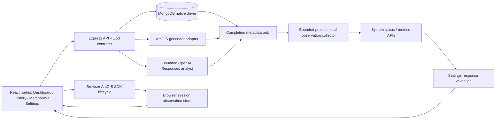
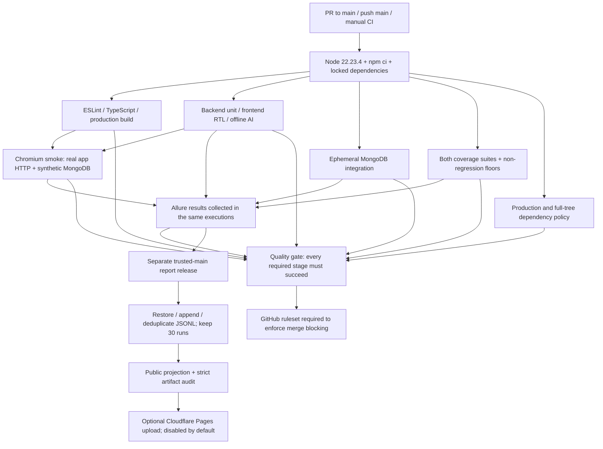

# Quality engineering architecture and final audit

Audit date: **2026-10-24** (America/Los_Angeles). Base: main commit `c15225dbbf73a021855aacc4d3edbcc32a86a290`; audit fixes are on `feat/quality-engineering-audit`. Hosted CI evidence below belongs to that base, not the unpushed audit changes. This document supersedes historical test counts, not the original coverage floors.

## Application and evidence boundaries

The collector is optional instrumentation, not a business database or source of truth for earnings. Adapter exceptions remain business failures; exceptions in telemetry sinks alone are isolated. Mongo command monitoring reads completion category/duration and error name/numeric code, never command bodies, replies or namespaces. ArcGIS records one logical geocode; OpenAI records one analyst request with separate model-call totals. Ping command events are excluded from command monitoring because the explicit bounded health probe records them once.

`GET /api/system/status` performs/coalesces a Mongo ping (1.5-second bound, five-second cache) and reports 24-hour observations. `GET /api/system/metrics?window=1h|24h` only reads retained observations. Neither endpoint invokes paid providers. Refresh can return the cached ping within five seconds; it is not an unconditional new network probe. Backend startup still requires MongoDB and an ArcGIS geocoding key; the factory's missing-key tests do not establish that an unconfigured production server can start.

Browser observations report map/layer initialization or update outcomes across in-app navigation. Reload resets them. They do not count all ArcGIS requests or measure ArcGIS connectivity. Dashboard retains the existing controller and lifecycle cleanup. Settings cancels stale requests, uses settled results independently, labels retained status stale, and does not poll.

## Signal definitions

| Signal | Definition and limitations |
| --- | --- |
| Observed provider status | Unconfigured overrides evidence. No evidence = Not Yet Verified; success only = operational; failure only = unavailable; mixed = degraded. This is retained evidence, not uptime or CI status. |
| Request/sample count | One retained operation. Mongo commands, geocodes and analyst requests have different units; their total is activity, not a global availability denominator. |
| Operation success rate | `successCount / requestCount × 100`. Zero denominator = unavailable, never 0%/100%. Success + failure + no-match + low-confidence = request count. Expected geocoding rejections reduce operation success but do not count as provider outages. |
| Mongo command success | Driver command completion, not proof of committed business writes. An `ok:1` reply can contain per-write errors; monitoring intentionally never parses that private reply. Failures before dispatch are not command samples. |
| Latency | Measured operation duration, including failures and expected business outcomes. Nearest-rank p50/p95: sorted element `ceil(n × quantile) − 1`. Samples 1..20 yield p50=10, p95=19, mean=10.5. Empty = null. Wall-clock timing is not a monotonic/distributed tracing clock. |
| AI requests / calls | Analyst requests and actual SDK invocations are separate. One request can make multiple calls. Automatic SDK retries are disabled. Provider errors cannot exceed calls. |
| AI tokens | Only reported token fields are summed. Usage sample count shows how many calls supplied usage; absent usage stays null. Partial usage is not extrapolated to costs or complete usage. |
| Window and retention | `(now − window, now]`, 1h or 24h. Default cap 10,000 observations, eviction marks potentially incomplete windows. Memory resets on process restart; no multi-process aggregation or durable telemetry. |
| Test coverage | Executed source statements/branches/functions/lines, with all configured production source included. Coverage is not correctness, availability or test stability. |
| Flakiness | A failure followed by a pass on retry is evidence of an unstable attempt, not a measured long-term rate. CI fails flaky Playwright tests even if the retry passes. History is run snapshots, not an established statistical study. |

## Findings and fixes

| Finding | Resolution / evidence |
| --- | --- |
| Mongo business rejections could mark the database unavailable | `MongoServerError` 11000/121 become `request_rejected`, with no availability evidence; operation failure still counts. Codes 13/18 = authentication, 50/262 = timeout; unknown codes remain conservative provider failures. Eight new native regressions cover classification, recovery evidence, privacy and listener detach. |
| A zero-sample provider could appear healthy if supplied a timestamp; contradictory latency/AI denominators were accepted | Settings now validates zero-sample evidence, nonempty latency, ordered quantiles, operation totals, AI request/call/error/usage relationships and integer token counts. Nine additional Settings tests reject contradictions and retain valid partial usage. |
| One browser telemetry subscriber could interrupt map notification | Isolate each listener's exception and use a stable subscription function. Regression verifies the next subscriber still receives observations/reset and unsubscribes cleanly. |
| Potentially misleading operational terminology | Document command-completion versus business-write success, operation success versus provider evidence, mixed request units and ping caching. No unrelated application calculation was rewritten. |

Mongo numeric codes follow the [MongoDB error-code reference](https://www.mongodb.com/docs/manual/reference/error-codes/). Only bounded numeric metadata is used; raw error messages/key values are excluded.

## Test layers and CI gates

| Layer | Current measured results | Boundary |
| --- | --- | --- |
| Backend native Node tests | **178** total: **137 unit**, **41 integration** | Domain/API contracts, fault injection, privacy, reporting/history/CI guards; real driver with disposable MongoDB for integration. |
| Frontend Vitest/RTL | **144 tests, 19 files** | Real component state/validation and map controller; mocked fetch/SDK boundaries. |
| Offline AI evaluation | **39/39 scenarios** | Scripted Responses clients; zero real provider calls. Not a live-model accuracy benchmark. |
| Chromium E2E | **9/9, 5.3 seconds**, no retry/skip in this run | All four routes, filters/analytics, delivery entry/validation, merchant CRUD, Settings unknown/503/partial/malformed/refresh, 390px mobile. Real HTTP/MongoDB; injected geocoder and SDK contract adapter. |
| Reporting verification | Three actual adapters: pass/fail/skip, intentional exit 1 each | Static HTML rendered; zero external requests/browser errors. Git-metadata projection and bounded history replay verified. |
| Gate demonstration | **137 pass → 135 pass / 2 fail → 137 pass** | Same blocking backend command; deliberately broken ping evidence only in disposable local source. See [demo](quality-gate-demo.md). |

The CI matrix runs unit suites and coverage suites for separate quality signals. Reporters do not rerun a suite. The consolidated audit report contains **653 executions**, not 653 unique tests: 178 backend coverage + 137 backend unit + 41 integration + 144 frontend unit + 144 frontend coverage + 9 E2E. Offline evaluation is a separate gate, not an Allure adapter. The intentional demo/probe failures are isolated and do not enter the application report/history.

Allure 3.22.1 uses aligned 3.14.0 adapters. Node 22 uses the native reporter-only backend integration, with no Node 26 preload or unsupported runtime calls. Batch exit codes and CI checks remain authoritative: a collection/startup failure can leave no per-test result for the missing suite even when other reported tests passed. Do not interpret an incomplete set of green test cases as a green job.

## Fresh validation and coverage

Verified with Node **22.23.4**, npm **10.9.0**, the committed lockfile and a Git-object source export overlaid with the audit changes. Dependencies were installed afresh with `npm ci`; no real `.env`, prior modules, credentials or data were copied. MongoDB 7.0.24 ran in a separate loopback-only, tmpfs-backed container with fixed synthetic test credentials. The existing developer MongoDB container was not used. Database helpers reject ambient URIs and hash approved test names into `dgi_ci_test_*` namespaces.

| Command | Actual outcome |
| --- | --- |
| `npm ci` | Passed; lockfile reproduced installation; audit reported zero vulnerabilities. |
| `npm run quality:check` | Exit 0: lint, strict types, quality production build, both coverage suites, 39 AI scenarios, coverage enforcement. |
| `npm run test:backend:unit` | Exit 0; 137 passed in the fresh copy. |
| `npm run test:backend:integration` | Exit 0; 41 passed against the dedicated test service. |
| `npm run test:frontend` | Exit 0; 144 passed after repairing an interrupted temporary source copy. |
| `npm run test:e2e` | Exit 0; 9 passed in 5.3 s. |
| `npm run security:check` | Exit 0; production and full dependency trees each reported zero known npm vulnerabilities. |
| `npm run allure:verify` | Exit 0; expected failing probes preserved exit 1 and sanitized diagnostics. |
| `npm run allure:generate` | Exit 0; 653 real executions, all three layers, `partial=false`. |
| `npm run allure:publish:prepare` / `allure:publish:check` | Exit 0; strict local dry-run candidate, zero public attachments; no Cloudflare upload. |
| `npm run quality:demo` | Exit 0 only after verifying the expected 0/1/0 sequence and Allure failure evidence. |
| actionlint 1.7.12 | Both tracked workflow YAML files passed. |

| Scope | Statements | Branches | Functions | Lines |
| --- | ---: | ---: | ---: | ---: |
| Backend measured | **94.44%** | **92.19%** | **96.93%** | **94.44%** |
| Backend unchanged floor | 93.71% | 90.86% | 95.86% | 93.71% |
| Frontend measured | **89.45%** | **84.92%** | **88.18%** | **92.36%** |
| Frontend unchanged floor | 89.08% | 84.33% | 87.38% | 92.00% |

No difficult file was excluded and no threshold was lowered. Coverage alone does not justify an arbitrary 80% policy. Ratchet a specific floor after reviewing stable source scope and repeat measurements; keep provider error-path tests mandatory.

Observed verification issues are not hidden: the synchronized original workspace's backend unit invocation timed out loading `test/api.test.mjs` at 30 seconds; its runner returned 1. That environment-specific failure was not marked passed or given a longer timeout. Fresh dependency/source validation and all integration cases passed; the exact OS/file-sync stall remains unresolved. An interrupted filesystem copy initially left an empty frontend test file; re-exporting from Git objects fixed the copy, without changing that test. The first demo harness omitted workflow fixtures; adding them restored its true baseline. Existing ArcGIS chunk-size and native reporter listener warnings remain visible; no warning suppression/global listener-limit increase was added. Untracked numbered sync copies in the developer workspace were preserved and excluded from the Git export.

## Hosted evidence and external setup

- [Main CI 40137015043](https://github.com/Shaobangzhu/delivery-geo-intelligence/actions/runs/40137015043), commit `c15225d`: **success**.
- [Quality report release 40137232249](https://github.com/Shaobangzhu/delivery-geo-intelligence/actions/runs/40137232249): **Prepare trusted quality report succeeded**, Cloudflare publish **skipped**. Logs identify source CI 40137015043, first-run/expired history behavior, 617 pre-audit executions and a successful trusted-main publication audit.
- Actual artifacts: `quality-report-history-main` (90-day retention, expires 2027-01-22) and `quality-report-publication` (7-day retention, expires 2026-10-31). Thus first-run trusted main preparation is verified. Restoring history from a second real main run is not yet verified; deterministic fake-GitHub/JSONL replay tests cover the mechanism.
- Repository rulesets API returned `[]`; classic main protection API returned HTTP 403 to the connected integration. **Required merge protections are not verified**. Configure the exact required checks in [CI setup](ci.md), require PR review/up-to-date checks, block force pushes, and review bypass actors. Workflow failure propagation alone cannot enable branch protection.
- No Pages deployment, live report URL, Cloudflare Access policy, actual secret placement, or protected-environment approval rules were verified or changed.

## Security, maintenance and readiness

Telemetry retains no raw residential address, precise private destination coordinate, prompt/completion, authorization header or database command. Synthetic regression sentinels exercise those boundaries and preserve destination coordinate generalization. Report results are projected and hashed; public candidates drop **all** screenshots/traces, reject unexpected files/URLs/symlinks and verify vendor asset fingerprints. Only current trusted main CI artifacts can reach the separate release workflow. PR/fork artifacts cannot authorize deployment; secrets appear only in its guarded upload job. These are code-level guarantees, not proof that an administrator configured secrets/environments correctly.

The prebuilt Allure UI bundles its own older DOMPurify bytes despite the installed dependency override. A clean npm audit does not certify those bytes. Publication therefore retains explicit fingerprint/expiry review and is disabled by default; update/review upstream bundles before enabling public hosting. Access protection is recommended but not claimed active. Regex sentinel checks are defense in depth, not a universal PII detector; reviewed synthetic fixtures and projection/attachment removal are the main publication boundaries.

The architecture is suitable for an evidence-driven interview review and a small repository's quality gates. It does not establish live ArcGIS/OpenAI availability, real WebGL correctness, distributed failover, multi-repository adoption, measured productivity improvement or a historical flakiness rate. Keep the small collector rather than adding an observability framework at this scale. Potential next work: verify repository/environment protection, exercise second-main-run history restore, resolve the synchronized-checkout stall, review/update the prebuilt report UI, collect repeated scheduled test evidence, then consider reusable workflows/versioned schemas across repositories. Durable telemetry, distributed tracing and organization-wide analytics remain future designs.
